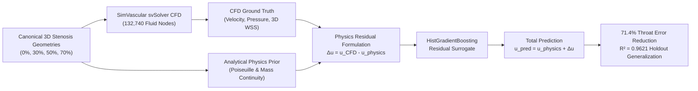

# HemoDyn-AI v2

[](https://www.python.org/downloads/)
[](https://opensource.org/licenses/MIT)
[](tests/)
[](https://github.com/z5rcnws7bz-eng/HemoDyn-Ai-v2)

**Production-grade scientific benchmark and Python package coupling Navier-Stokes finite element computational fluid dynamics (CFD) with physics-guided machine learning (PGML) surrogates for 3D arterial stenosis hemodynamics.**

Developed by **Jace E. Roman** at **Temple University** (Philadelphia, PA).

---

## Highlights

- **Physics-Guided Residual Surrogate**: Rather than predicting velocity with unconstrained black-box regression, HemoDyn-AI learns the physical discrepancy residual $\Delta u(\mathbf{x}) = u_{\text{CFD}}(\mathbf{x}) - u_{\text{physics}}(\mathbf{x})$ anchored to an analytical mass-conserving Poiseuille/continuity prior.
- **71.4% Throat Error Reduction**: In the high-gradient stenosis constriction ($z \in [55, 65]\text{ mm}$), geometry-only ML exhibits $131.52\text{ mm/s}$ RMSE. Physics-guided ML cuts throat error to **$37.55\text{ mm/s}$ RMSE** ($23.66\text{ mm/s}$ MAE).
- **Cross-Geometry Holdout Generalization**: Evaluated on completely unseen $50\%$ moderate stenosis geometry ($43,804$ fluid nodes), achieving $R^2 = 0.9621$ ($17.29\text{ mm/s}$ RMSE) vs. $R^2 = 0.8919$ ($29.21\text{ mm/s}$) for standard ML.
- **1-Click Interactive Walkthrough Notebooks**: Clean, reproducible Jupyter notebooks in [`notebooks/`](notebooks/) exploring CFD progression, training surrogates, and evaluating regional diagnostics.

---

## Benchmark Overview



### 4-Case CFD Hemodynamic Progression Summary

| Configuration | Severity | Throat Diam ($D$) | Peak Velocity | Pressure Drop ($\Delta P$) | Maximum WSS |
| :--- | :---: | :---: | :---: | :---: | :---: |
| **Healthy Baseline** | $0\%$ | $4.00\text{ mm}$ | $200.7\text{ mm/s}$ | $10.6\text{ dyn/cm}^2$ | $4.18\text{ dyn/cm}^2$ |
| **Mild Stenosis** | $30\%$ | $3.34\text{ mm}$ | $303.4\text{ mm/s}$ | $23.1\text{ dyn/cm}^2$ | $10.45\text{ dyn/cm}^2$ |
| **Moderate Stenosis** | $50\%$ | $2.82\text{ mm}$ | $440.0\text{ mm/s}$ | $52.7\text{ dyn/cm}^2$ | $24.71\text{ dyn/cm}^2$ |
| **Severe Stenosis** | $70\%$ | $2.19\text{ mm}$ | $880.8\text{ mm/s}$ | $189.4\text{ dyn/cm}^2$ | $74.52\text{ dyn/cm}^2$ |

### 5-Zone Regional Error Decomposition (50% Stenosis Holdout)

| Region | Axial Span ($z$) | Node Count | Physics Prior RMSE | Geometry ML RMSE | Physics-Guided ML RMSE | Error Reduction |
| :--- | :---: | :---: | :---: | :---: | :---: | :---: |
| **Upstream Inlet** | $0 - 50\text{ mm}$ | 19,656 | $2.36\text{ mm/s}$ | $0.88\text{ mm/s}$ | **$0.74\text{ mm/s}$** | $+15.6\%$ |
| **Approach Zone** | $50 - 55\text{ mm}$ | 1,644 | $29.72\text{ mm/s}$ | $14.11\text{ mm/s}$ | **$13.13\text{ mm/s}$** | $+7.0\%$ |
| **Stenosis Throat** | $55 - 65\text{ mm}$ | 1,511 | $47.48\text{ mm/s}$ | $131.52\text{ mm/s}$ | **$37.55\text{ mm/s}$** | **$+71.4\%$** |
| **Post-Stenotic Wake**| $65 - 85\text{ mm}$ | 7,429 | $49.84\text{ mm/s}$ | $37.94\text{ mm/s}$ | **$37.54\text{ mm/s}$** | $+1.1\%$ |
| **Distal Recovery** | $85 - 121\text{ mm}$ | 13,564 | $5.10\text{ mm/s}$ | $3.86\text{ mm/s}$ | **$3.84\text{ mm/s}$** | $+0.6\%$ |

---

## Repository Structure

```text
HemoDyn-Ai-v2/
├── notebooks/                                # Walkthrough Jupyter notebooks
│   ├── 01_cfd_progression_benchmark.ipynb    # 4-case hemodynamic progression
│   ├── 02_physics_guided_ml_surrogate.ipynb  # Residual PGML training & evaluation
│   └── 03_cross_geometry_generalization.ipynb# Leave-one-geometry-out & regional error
├── src/hemodyn/                              # Modular Python scientific package
│   ├── __init__.py
│   ├── physics.py                            # Poiseuille & mass continuity equations
│   ├── surrogate.py                          # PhysicsGuidedSurrogate & GeometryOnlySurrogate
│   ├── data.py                               # 132,740-point benchmark dataset loaders
│   └── plotting.py                           # Publication-grade plotting styles
├── figures/                                  # Curated high-resolution publication figures
│   ├── 01_arterial_diameter_profiles.png
│   ├── 02_velocity_slices_absolute.png
│   ├── 03_velocity_slices_normalized.png
│   ├── 04_four_case_wss_3d_shared_scale.png
│   ├── 05_ml_50pct_regional_rmse.png
│   ├── 06_ml_reverse_flow_diagnostic.png
│   └── 07_hemodyn_ml_poster_panel.png        # Conference summary poster panel
├── data/
│   ├── geometries/                           # Canonical 3D manifold STL & VTP surfaces
│   └── simvascular_mm/                       # SimVascular models with scalar attributes
├── results/
│   ├── models/                               # Serialized surrogate weights (.joblib)
│   ├── data/                                 # 132,740-point extracted CFD dataset (.npz)
│   └── metrics/                              # Benchmark CSV summary tables
├── tests/
│   └── test_hemodyn_v2.py                    # Automated pytest verification suite
├── pyproject.toml                            # Modern Python packaging configuration
├── requirements.txt                          # Pip dependency specifications
├── environment.yml                           # Conda environment definition
├── reproduce.sh                              # 1-command end-to-end reproduction script
├── CITATION.cff                              # CFF v1.2.0 citation metadata
└── LICENSE                                   # MIT License (Copyright 2026 Jace E. Roman)
```

---

##  Quickstart

### 1. Installation

```bash
git clone https://github.com/z5rcnws7bz-eng/HemoDyn-Ai-v2.git
cd HemoDyn-Ai-v2

python3 -m venv .venv
source .venv/bin/activate
pip install -r requirements.txt
pip install -e .
```

### 2. Run Test Suite

```bash
pytest tests/ -v
```

### 3. Run Master Reproduction Pipeline

```bash
./reproduce.sh
```

### 4. Interactive Jupyter Walkthroughs

```bash
jupyter notebook notebooks/
```

---

##  Citation

If you use this benchmark, surrogate model, or dataset in your research, please cite:

```bibtex
@article{roman2026hemodyn,
  author       = {Roman, Jace E.},
  title        = {{HemoDyn-AI v2: Physics-Guided Machine Learning Surrogates for 3D Arterial Stenosis Hemodynamics}},
  year         = {2026},
  institution  = {Temple University},
  url          = {https://github.com/z5rcnws7bz-eng/HemoDyn-Ai-v2}
}
```

---

##  Author & Affiliation

- **Jace E. Roman**
- Temple University, Philadelphia, PA, USA
- Contact: [jace.roman@temple.edu](mailto:jace.roman@temple.edu)
- GitHub: [@z5rcnws7bz-eng](https://github.com/z5rcnws7bz-eng)

